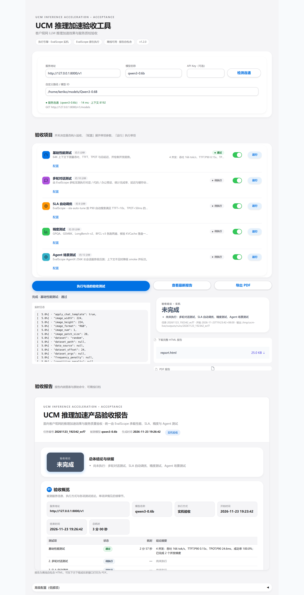
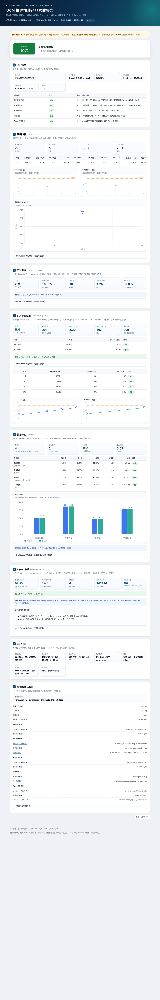

# UCM 推理加速产品 · 客户现网验收工具

[](https://github.com/ucm-system/ucm-accept/actions/workflows/ci.yml)
[](https://github.com/ucm-system/ucm-accept/actions/workflows/release.yml)
[](https://github.com/ucm-system/ucm-accept/releases)

面向交付/服务人员的**离线验收编排与呈现工具**。测试逻辑全部交给 [EvalScope](https://github.com/modelscope/evalscope)，本工具只负责：

- 预设五项验收测试的参数与顺序；
- 调用 EvalScope 原生 CLI；
- 收集 EvalScope 原始输出；
- 生成一份可离线归档的统一 HTML 报告；
- 提供 GUI（浏览器）与 CLI（容器菜单）两种形态。

> **设计红线**：不自行实现压测、并发搜索、精度评分或 Agent 指标算法。所有数值必须能追溯到 EvalScope 原始输出和可复现命令。



---

## 一、功能与 EvalScope 对应关系

| 验收项 | 默认行为 | EvalScope 原生命令 | 报告内容 |
|---|---|---|---|
| 基础性能 | 64K 上下文、20 并发、200 请求 | `evalscope perf` | 吞吐、TTFT/TPOT 的均值/P90/P99、总延迟、并发趋势图 |
| 多轮对话 | 对话 / 代码 / 办公三个预设，各 12 组会话 | `evalscope perf --multi-turn --dataset custom_multi_turn` | 会话完成率、总轮次、平均延迟、KV Cache 命中 |
| SLA 自动调优 | 64K 上下文，按 P90 搜索最高并发 | `evalscope perf --sla-auto-tune --sla-params '[{"p90_ttft":"<10000ms","p90_tpot":"<50ms"}]'` | 目标 200 并发是否达标、原生建议并发、探测点 |
| 精度测试 | GPQA / GSM8K / LongBench-v2(short) / BFCL-v3 各跑 2 遍 | `evalscope eval --work-dir ...` | 两次得分、均值、标准差、两遍偏差、KVCache 一致性 |
| Agent 场景 | AgentX 256K 长会话，服务级压测 | `evalscope perf --scenario agentx` | 服务级成功率、会话数、请求数、每会话请求数、降级标记 |

### 已经明确砍掉的内容

为了避免客户质疑“自研算法”，以下功能**不做**：

1. **自研 P90 并发搜索**：EvalScope 1.15 起原生 SLA 已支持 `p90_ttft` / `p90_tpot`，直接使用 `--sla-auto-tune`。
2. **多轮对话回放 / 工具调用轨迹展示**：EvalScope 多轮压测原生只输出统计指标，不输出可回放对话。本工具不伪造对话记录，报告中只呈现 EvalScope 指标与原始输出。
3. **Agent 任务完成率 / 平均步数 / 工具调用成功率**：EvalScope AgentX 是**服务级**长会话压测，不是模型任务质量评测。本工具不自行计算这些任务级指标；如需请另配独立的 Agent 评测任务集。
4. **精度分数自研计算**：只解析 EvalScope `reports/<model>/<dataset>.json` 中的原生 score；解析失败即报错，不用估算值。
5. **PDF 强依赖**：HTML 报告可用浏览器打印为 PDF；安装 WeasyPrint 或 Chromium 后可用按钮/命令直接导出。

### 两个容易混淆的口径

- **SLA**：EvalScope 原生 `--sla-auto-tune` 用阈值做边界搜索，报告中的“建议并发”是 EvalScope 的搜索结果；目标并发（默认 200）是否达标，以 EvalScope 原生选择出的建议并发与目标并发比较判定；报告中同时展示 200 并发探测点（若被搜索到）。
- **AgentX**：`submission_valid=false` 或 `mode=smoke` 的结果只能用于服务级参考，不能作为模型质量或标准 256K 验收结论。报告会显著标注。

---

## 二、快速开始

### 2.1 环境要求

- Python 3.10+（GUI/CLI 工具本体）
- **EvalScope >= 1.15**（`p90_ttft` / `p90_tpot` 需要）
- Agent 场景额外需要：Python 3.11–3.13、`evalscope[agentx]`、`aiperf==0.12.0`
- 离线环境需预置：数据集、tokenizer、Python wheel 包

推荐容器/服务器使用 Python 3.11。

```bash
python -m venv .venv
source .venv/bin/activate
pip install -e ".[gui]" "evalscope[perf,service]>=1.15,<2"
# 需要 Agent 场景时（Python 3.11–3.13）：
pip install "evalscope[agentx]>=1.15,<2"
```

### 2.2 不用真实模型，先走通全流程

```bash
ucm-accept --mock --fast --all --outputs ./outputs
```

报告会标注“模拟数据，不能作为验收结论”，但流程、图表、报告结构、命令追溯与实机一致。

### 2.3 GUI（桌面 / 浏览器）

```bash
ucm-accept --gui --base-url http://127.0.0.1:8801/v1 --model Qwen2.5-0.5B-Instruct
```

- 启动后自动选择随机可用端口，并尝试打开系统浏览器；
- 无桌面环境时自动降级为打印访问地址；
- 页面只展示业务概念，并发梯度、请求数、命中率等折叠在“高级选项”。

演示：

```bash
ucm-accept --gui --mock --fast
```

### 2.4 CLI（服务器 / 堡垒机 / 容器）

```bash
ucm-accept --base-url http://127.0.0.1:8801/v1 --model Qwen2.5-0.5B-Instruct
```

进入菜单后按数字选择，`A` 全跑，`R` 查看最近报告，`S` 修改服务地址，`Q` 退出。

非交互：

```bash
ucm-accept --all
ucm-accept --item perf
ucm-accept --item multiturn --scenario code
ucm-accept --all --report /data/ucm-report.html
ucm-accept --doctor --probe
```

退出码：

| 场景 | 退出码 |
|---|---|
| 全部通过 / 有条件通过 | 0 |
| 不通过 | 2 |
| 未完成 / 执行异常 | 3 |
| 单项通过 / 关注 | 0 |
| 单项未通过 | 2 |

### 2.5 容器

```bash
docker run --rm -it \
  -v /data/ucm:/data \
  ucm-accept:latest \
  --config /etc/ucm-accept/config.yaml --outputs /data/outputs
```

离线多架构构建见 [docs/offline-build.md](docs/offline-build.md)。

---

## 三、界面与流程

### 3.1 GUI 首页

- 顶部：服务地址、模型名称、API Key、连通状态；
- 中部：五项测试卡片（名称、一句话说明、预计耗时、运行按钮）；
- 底部：一键全跑、实时进度、执行日志、报告预览与下载、PDF 导出；
- “高级选项”折叠：性能并发梯度、请求数、上下文长度、输出长度、前缀命中率、SLA 模式与阈值、精度遍数、多轮/Agent 并发等。

### 3.2 CLI 菜单

```text
====================================================
 UCM 推理加速验收工具 (CLI)  v1.1.0
 执行引擎: EvalScope 实机
====================================================
服务地址: http://127.0.0.1:8801/v1
模型:     Qwen2.5-0.5B-Instruct
报告目录: ./outputs
----------------------------------------------------
 [1] 基础性能测试    约 5 分钟
 [2] 多轮对话测试    约 10 分钟
 [3] SLA 自动调优    约 8 分钟
 [4] 精度测试        约 20 分钟
 [5] Agent 场景测试  约 15 分钟
 [A] 执行全部验收测试
 [R] 查看最近报告
 [S] 修改服务地址 / 模型
 [Q] 退出
----------------------------------------------------
请选择:
```

### 3.3 进度与报告

- GUI 使用 Gradio 进度条显示当前阶段；日志区保留 EvalScope 输出摘要；
- CLI 使用步骤编号 + ✓ / ! / ✗ + 百分比；
- 每一项结束后立即写 `report.json` / `report.html`，即使中途中断也可查看已完成部分；
- 全部完成后生成统一验收报告。

---

## 四、验收报告



报告是**完全自包含的离线 HTML**：内嵌 CSS 与 SVG 图表，不依赖外网字体、JS、CDN。

章节：

1. **概览**：服务信息、执行时间、总耗时、五项状态、总体结论（通过 / 有条件通过 / 不通过 / 未完成）。
2. **基础性能**：指标表 + TTFT/TPOT/吞吐趋势图。
3. **多轮对话**：场景、会话完成率、轮次、延迟、缓存命中；明确注明不回放对话。
4. **SLA 自动调优**：目标阈值 vs 实测 P90、建议并发、探测点、差距说明。
5. **精度**：两遍得分、均值、标准差、两遍偏差、稳定性判定，附两次柱状对比图。
6. **Agent**：AgentX 服务级指标、上下文、`submission_valid`、降级标记、口径说明。
7. **验收口径**：本次使用的 SLA/精度/Agent 参数。
8. **原始数据与复核**：每项的 EvalScope 执行命令、原始输出目录、`command.txt`、`report.json`、`run.log`、原生 HTML/JSON 报告链接。

### 可复现性设计

- 每项输出目录内都有 `command.txt`，记录**脱敏后的完整 EvalScope 命令**；
- 报告“执行命令”折叠块可一键复制；
- 原始数据目录完整保留 `evalscope.log`、`benchmark_summary.json`、`benchmark_percentile.json`、`reports/` 等；
- 报告只汇总 EvalScope 数值，不二次计算分数；除均值/标准差/两遍偏差这类**展示统计**外，不做任何评分推断；
- 原始报告链接直接指向本地 EvalScope HTML/JSON。

### 输出目录

```text
outputs/
├── latest.txt                       # 最近一次报告指针
└── runs/<run_id>/
    ├── report.html
    ├── report.json
    ├── summary.json
    ├── run.log
    ├── items/<key>.json
    └── evalscope/
        ├── perf/...
        ├── multiturn/dialogue/...
        ├── sla/...
        ├── accuracy/<dataset>/run1|run2/...
        └── agent/...
```

---

## 五、配置

默认配置在 [`ucm_accept/resources/config.yaml`](ucm_accept/resources/config.yaml)，所有预设参数外置。支持：

```bash
ucm-accept --config /etc/ucm-accept/config.yaml ...
```

也支持环境变量展开：

```yaml
endpoint:
  base_url: ${UCM_BASE_URL:-http://127.0.0.1:8801/v1}
  model: ${UCM_MODEL:-Qwen2.5-0.5B-Instruct}
perf:
  tokenizer_path: ${UCM_TOKENIZER_PATH:-/opt/ucm-accept/assets/tokenizers/Qwen2.5-0.5B-Instruct}
```

### 关键配置

| 配置项 | 默认 | 说明 |
|---|---|---|
| `endpoint.base_url` | `http://127.0.0.1:8801/v1` | OpenAI 兼容服务根地址 |
| `endpoint.model` | `Qwen2.5-0.5B-Instruct` | 被测模型名 |
| `perf.parallel` | `[20]` | 性能并发梯度 |
| `perf.number` | `200` | 每个并发点请求数 |
| `perf.max_prompt_length` | `65536` | 64K 上下文 |
| `perf.max_tokens` | `256` | 输出长度 |
| `sla.mode` | `auto_tune` | `auto_tune`（原生 P90 搜索）或 `verify`（只测目标并发） |
| `sla.target` | 64K / 200 / 10s / 50ms | SLA 验收口径 |
| `accuracy.runs` | `2` | 每项精度执行遍数 |
| `accuracy.datasets` | GPQA、GSM8K、LongBench-v2、BFCL-v3 | 数据集与子集 |
| `agent.duration_s` | `900` | AgentX benchmark 最短 900 秒 |
| `app.report_dir` | `./outputs` | 报告根目录 |
| `evalscope.executable` | `evalscope` | 可指向离线 venv 内的可执行文件 |
| `evalscope.min_version` | `1.15.0` | `--doctor` 校验 |

### 高级选项与命令行映射

- 命中率 → `--prefix-length`（仅 `random` 数据集）；
- 并发梯度 → `--parallel 10 20 40 --number 200 200 200`；
- SLA 模式 → 原生 `--sla-auto-tune` 或单点 `perf`；
- 精度样本数 → `eval --limit`。

### 命令模板覆写

不同客户现场的 EvalScope 版本可能存在参数差异。可在配置中整体覆写 argv：

```yaml
evalscope:
  perf_command: ["/opt/venv/bin/evalscope", "perf", "--model", "{model}", "..."]
  accuracy_command: ["evalscope", "eval", "--model", "{model}", "..."]
  multiturn_command: []
  agent_command: []
```

支持占位符：`{model}`、`{url}`、`{base_url}`、`{api_key}`、`{output_dir}`、`{dataset}`、`{tokenizer}`、`{limit}`、`{parallel}`、`{number}`。

> 建议优先使用内置参数构造器，只有版本差异时才覆写。覆写命令同样会写入 `command.txt`。

---

## 六、现场自检

```bash
ucm-accept --doctor --probe
```

检查项：

- Python 版本、配置合法性、报告目录可写；
- EvalScope 是否存在及版本是否 >= 1.15；
- AgentX 依赖 `aiperf`；
- GUI 依赖 `gradio`；
- 内置多轮预设数据与 SHA256；
- tokenizer 路径；
- 服务连通性（`/v1/models`，必要时 `/v1/chat/completions`）；
- PDF 导出组件。

---

## 七、离线构建

完整流程见 [docs/offline-build.md](docs/offline-build.md)。核心原则：

1. 在联网构建机预下载全部 Python wheel、数据集、tokenizer；
2. 所有物料落到固定路径并生成 SHA256 清单；
3. 用 `--doctor` + `--mock --fast --all` 做虚跑校验；
4. 产出 exe / deb / rpm / 双架构镜像时复用同一份物料与同一份 `config.yaml`；
5. 现场只用离线安装命令，不访问外网。

---

## 八、开发与测试

```bash
pip install -e ".[dev]"
pytest -q
ruff check ucm_accept tests
```

测试覆盖：

- 配置合并 / 环境变量 / 校验；
- EvalScope 控制台与 JSON 输出解析（含真实 `benchmark_summary.json` / `benchmark_percentile.json` / AgentX `metrics` 结构）；
- 模拟引擎全流程、降级画像、进度事件；
- 报告 HTML 自包含、XSS 转义、原始链接；
- CLI 全跑 / 单项 / 导出 / 自检；
- GUI 构建（子进程）与高级参数校验；
- EvalScope CLI 参数拼装（用假 executable 验证，不产生真实模型流量）。

---

## 九、已知边界

1. **EvalScope 版本**：低于 1.15 不支持 `p90_ttft` / `p90_tpot`，`--doctor` 会告警；请升级或使用 `sla.mode=verify`（只测 200 并发）。
2. **AgentX 不是任务评测**：只输出服务级指标；任务质量请另配评测。
3. **多轮对话无回放**：EvalScope 原生不提供可回放 transcript；报告不编造。
4. **PDF**：默认只有 HTML；PDF 需 WeasyPrint / Chromium，或浏览器打印。
5. **数据集离线**：EvalScope 数据集缓存路径由 EvalScope/ModelScope 管理，建议在构建机预热后整目录打包；详见离线构建文档。
6. **Kylin 桌面**：GUI 依赖系统浏览器与 Python 运行时；deb 包需在对应麒麟版本上验证。
7. **Agent 上下文降级方式**：低于 256K 时只能降级为 EvalScope AgentX `smoke`（固定 4 条 trace），不是按任意上下文裁剪任务集；smoke 指标不可与标准 256K 结果比较。
8. **模拟模式**：`--mock` 仅用于演示与 CI 虚跑，报告显著标注，不产生真实请求。

---

## 十、目录结构

```text
ucm_accept/
├── cli.py                 # 菜单 / 非交互 CLI
├── gui.py                 # Gradio BS 界面
├── service.py             # GUI/CLI 共用会话服务
├── orchestrator.py        # 五项编排、进度、落盘
├── report.py              # 自包含 HTML / SVG / PDF
├── config.py              # YAML 合并 / 环境变量 / 校验
├── models.py              # 结果模型与结论规则
├── doctor.py              # 现场自检
├── engine/
│   ├── evalscope_engine.py# EvalScope 原生 CLI 适配
│   ├── parser.py          # 官方输出解析
│   ├── mock.py            # CI / 演示用的确定性模拟
│   └── chat.py            # 连通性与上下文探测（最小实现）
└── resources/
    ├── config.yaml
    ├── assets_manifest.json
    └── datasets/multiturn/{dialogue,code,office}.jsonl
```
